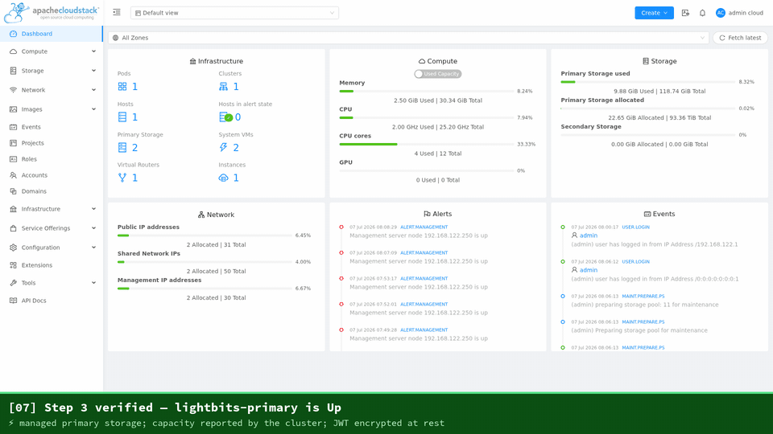

# cloudstack-lightbits

Apache CloudStack primary storage plugin for [Lightbits](https://www.lightbitslabs.com) NVMe/TCP block storage.

> **Status: pre-alpha, under active development.** Nothing here is ready for production use. APIs, layout, and behavior will change without notice.



*Registering the Lightbits cluster as primary storage, then deploying VMs whose root disks are Lightbits NVMe/TCP volumes.*

## What this is

A CloudStack **managed primary storage** driver that provisions VM disks as Lightbits volumes served over NVMe/TCP — NVMe-class performance on standard TCP/IP networks, no special NICs or switch configuration required. Each CloudStack volume maps 1:1 to a Lightbits volume.

Two communication paths:

- **Control path** — the CloudStack management server calls the Lightbits REST/gRPC API (volume lifecycle, snapshots, clones, ACLs, capacity).
- **Data path** — KVM hosts connect to volumes with NVMe/TCP (`nvme-tcp` kernel module + `nvme-cli`) and hand the raw block device to QEMU.

## Scope

Working today (KVM):
- Volume create/delete, attach/detach via per-host NQN ACLs (host NQN auto-registered)
- VM root disks from templates via native snapshot+clone (template cached once per pool)
- Volume snapshots: take / revert (native in-place rollback) / delete, and create-volume-from-snapshot
- Volume resize (grow, offline — online resize of managed KVM disks is restricted by CloudStack itself)
- Per-volume replica factor via the `lightbitsReplicas` offering detail
- Cluster-wide and zone-wide storage pools; full cluster-side cleanup on teardown

Planned:
- QoS mapping from CloudStack disk offerings to Lightbits QoS policies

See [docs/architecture.md](docs/architecture.md) for the design sketch.

## Installing

See **[INSTALL.md](INSTALL.md)** for the full deployment guide (management server + KVM hosts,
pool registration, storage tags) and **[docs/jwt-rotation.md](docs/jwt-rotation.md)** for
credential rotation.

## Requirements (target)

- Apache CloudStack 4.22+
- Lightbits cluster running LightOS ≥ 3.x, reachable from the management server (API, port 443) and KVM hosts (NVMe/TCP, port 4420). Any cluster size works — from a single node (use `replicas=1`) up to a full multi-node cluster; three nodes are **not** required.
- KVM hosts: `nvme-cli`, `nvme_tcp` kernel module

## Building

CloudStack does not publish its Maven artifacts to Maven Central; building this plugin requires a locally installed CloudStack source tree:

```bash
git clone --depth 1 --branch 4.22.1.0 https://github.com/apache/cloudstack.git
cd cloudstack && mvn -B -DskipTests install -pl api,core,engine/api,engine/storage,engine/storage/volume,framework/ipc,plugins/hypervisors/kvm -am
cd ../cloudstack-lightbits && mvn -B verify   # compiles, runs the unit tests, enforces coverage
```

## Testing

Unit tests live under `src/test/java` and run with the standard Maven lifecycle — no
CloudStack management server or Lightbits cluster required (the API is exercised against an
in-process [WireMock](https://wiremock.org/) stub):

```bash
mvn -B test            # run the unit tests
mvn -B verify          # tests + JaCoCo line-coverage gate (fails under 60%)
```

Coverage report after a run: `target/site/jacoco/index.html`.

**Contributors are encouraged to extend these.** The suite is organized by unit:

| Test | Covers |
|---|---|
| `client/LightbitsApiClientTest` | volume/snapshot lifecycle, idempotency, error mapping, retry/backoff |
| `client/LightbitsApiClientTlsTest` | TLS certificate validation (self-signed rejected; no silent bypass) |
| `util/LightbitsPoolConfigTest` | pool-URL parsing/validation, JWT-never-persisted contract |
| `lifecycle/LightbitsLifeCyclePreflightTest` | pool preflight against a stubbed cluster |

When adding an API call to `LightbitsApiClient`, add a WireMock-backed test alongside it (happy
path **and** the failure it must handle). The coverage gate covers the `client`, `util`, and
`model` packages; the CloudStack-coupled SPI classes are validated by integration/Marvin tests.

## Delivery model

This is a **standalone (out-of-tree) plugin**, installed onto existing CloudStack deployments — the same model as [StorPool's CloudStack integration](https://github.com/storpool/storpool-cloudstack-integration) and our own [pve-lightbits](https://github.com/LightBitsLabs/pve-lightbits). The codebase is kept upstream-compatible (Apache 2.0, ASF-clean dependencies, in-tree-compatible layout) so contribution to `apache/cloudstack` remains an option in the future.

## Contributing

See [CONTRIBUTING.md](CONTRIBUTING.md).

## License

[Apache License 2.0](LICENSE)
